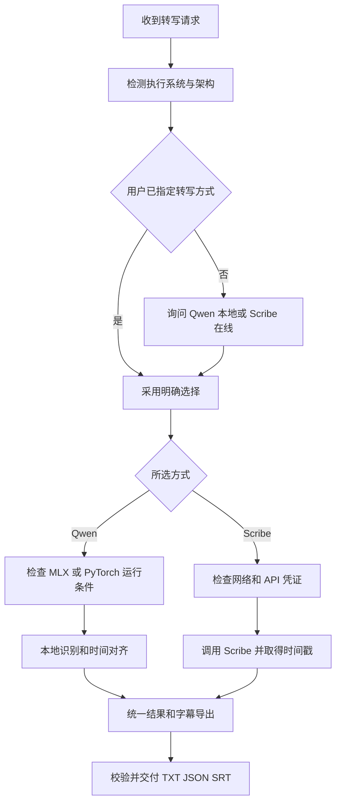

# ASR Skill 跨平台改造技术需求文档

版本：1.0  
日期：2026-11-08  
实施对象：负责改造现有 skill 的 coding agent

在现有 skill 中增加统一的文件转写能力：先检测执行环境，再由用户选择本地 Qwen3-ASR-1.7B（推荐）或在线 ElevenLabs Scribe V2。Apple Silicon Mac 使用 MLX，Windows 优先使用 PyTorch 与 CUDA。两条路线统一输出文本、带时间信息的 JSON 和 SRT 字幕。

本文件定义产品行为、实现约束及验收要求。实施时先读取现有 skill 和仓库指令，再映射到现有目录与接口；文中的模块名是建议，不要求重建整个 skill。

# 1 目标与范围

## 本期必须实现

- 自动检测系统、CPU 架构及所选路线的运行条件。
- 提供 Qwen3-ASR-1.7B 本地转写和 Scribe V2 在线转写两种选择。
- 支持中文、英文及中英混合录音；用户明确指定语言时尊重该设置，混合语言默认自动识别。
- 支持常见音频文件和视频音轨转写，包括 WAV、MP3、M4A、FLAC、MP4、MOV。
- 本地 Qwen 配合 ForcedAligner 获得时间信息；Scribe 使用 API 返回的词级时间信息。
- 输出 TXT、JSON 和 SRT；VTT 作为可选扩展。
- 支持长录音分块、模型缓存、错误恢复、取消和处理阶段提示。
- 保留现有 skill 的触发方式、输入来源及后续处理能力，明确记录行为变化。

## 本期边界

本期实现离线文件处理流程。实时麦克风、实时字幕、TTS、声音克隆、训练和模型部署服务不属于必需范围。已有的这些能力应保留，不在本次顺带重构。

识别模型固定为 1.7B，不因英文输入、内存不足或运行失败自动切换 Parakeet、Whisper 或 Qwen3-ASR-0.6B。对齐模型使用 0.6B 是不同功能，不属于降低识别模型规格。

# 2 技术决策与平台矩阵

| 环境 | 本地运行路线 | 识别权重 | 发布要求 |
| --- | --- | --- | --- |
| macOS Apple Silicon | 社区 mlx-qwen3-asr，MLX 与 Metal | 默认 mlx-community/Qwen3-ASR-1.7B-8bit | 主要支持路线，完成实机验收 |
| macOS Intel | 不运行本方案的 MLX 后端 | 本期不配置 | 正确识别限制，提供在线选项 |
| Windows x64，CUDA 可用 | 官方 qwen-asr，Transformers 与 PyTorch CUDA | Qwen/Qwen3-ASR-1.7B | 主要实现目标，通过原生 Windows 实机验收后声明支持 |
| Windows x64，CUDA 不可用 | PyTorch CPU，FP32 | Qwen/Qwen3-ASR-1.7B | 慢速兼容模式，通过端到端验证后开放 |
| Windows ARM 或其他 GPU | 不默认配置专用加速后端 | 由后续适配确定 | 清楚报告当前支持状态 |
| WSL | 单独识别为 Linux 执行环境 | 可复用 PyTorch 路线 | 作为扩展验证，不能算作原生 Windows 验收 |
| 任一受支持系统，在线转写 | ElevenLabs SDK 或 HTTP API | scribe_v2 | 无需本地识别模型或 GPU |

两端使用相同模型家族，运行框架和权重格式不同。Mac 不使用 CUDA；Windows 不加载 MLX 量化权重。MLX 只在本项目的 Apple Silicon Mac 路线上启用。

官方 Qwen 包提供 Transformers 和 vLLM 后端，但官方 README 没有明确列出原生 Windows 兼容保证。因此 Windows 是本项目需要验证的支持目标，不能仅凭 PyTorch 支持 Windows 就宣布整条链路可用。[官方安装与接口](https://github.com/QwenLM/Qwen3-ASR#quickstart)

# 3 用户交互与状态流程

## 入口顺序

1. 读取当前请求，识别用户是否已经明确指定转写方式。
2. 检测实际执行脚本的系统和 CPU 架构，显示简短结果。
3. 未指定方式时询问用户；已经指定时直接采用。
4. 用户选择后，仅检查和准备该路线的依赖、凭证及模型。
5. 检查输入媒体，执行转写、时间对齐、字幕分句与导出。
6. 返回产物路径、实际使用的模型与后端、耗时及影响结果的问题。



## 标准询问

Apple Silicon Mac 示例：

> 检测到当前环境为 macOS，Apple Silicon。请选择转写方式：  
> 1. Qwen3-ASR-1.7B（推荐）：本地转写，使用 MLX，首次使用需要下载模型。  
> 2. Scribe V2（在线）：将音频上传至 ElevenLabs，需要 API 凭证，并按服务计费。

Windows 示例：

> 检测到当前环境为 Windows x64。请选择转写方式：  
> 1. Qwen3-ASR-1.7B（推荐）：本地转写，选择后检测 CUDA 加速条件。  
> 2. Scribe V2（在线）：将音频上传至 ElevenLabs，需要 API 凭证，并按服务计费。

已检测到本地路线不受支持时，在选项中注明限制，不能把不可执行的本地路线标为可直接使用。

## 选择与授权规则

- 询问只提供上述两个主要选项，不增加 BF16、8bit、6bit 的普通用户选择步骤。
- “推荐”只是推荐标记；用户未回答时不得自动采用。
- 用户在请求中明确指定 provider 时，不重复询问。
- 同一批任务复用本次选择；下一次交互任务未指定 provider 时仍询问。历史偏好可用于排列选项，不能当作本次提交。
- 非交互调用必须显式传入 provider；缺少时返回需要选择，不默认触发在线上传。
- 选择本地后可准备隔离环境和下载所需模型，沿用宿主已有权限机制；无需为已授权的常规步骤重复询问。
- 选择在线后可执行该批已指定文件的上传和计费调用；不扫描、上传其他文件。
- 本地失败后，不自动切换在线。若用户需要切换，重新明确选择即可，不再叠加重复确认。

# 4 环境检测与依赖管理

系统检测建议使用 Python 的 platform、sysconfig、sys 等标准能力。不能根据目录名、shell 或用户语言推断系统。

基础检测结果至少包含：

| 字段 | 说明 |
| --- | --- |
| os 和 architecture | 实际执行环境的系统与架构 |
| python_version 和 python_architecture | 当前解释器版本与位数 |
| is_wsl 和 is_rosetta | 区分 WSL、Apple Silicon 上的 Intel Python |
| ffmpeg_available 和 ffprobe_available | 媒体检测及预处理能力 |
| available_memory 和 free_disk | 可获取时记录，无法获取时使用 unknown |
| local_support_status | ready、needs_setup、unsupported 或 unverified |

模型运行检查在选定 provider 后进行。Scribe 路线不能因为没有 PyTorch、MLX 或 NVIDIA 驱动而被阻塞。

在 Apple Silicon 上检测到 Intel Python 时，引导切换原生 ARM64 Python，不能继续安装后才发现 MLX 不可用。

依赖安装使用现有 skill 的隔离环境机制；没有约定时使用独立虚拟环境。每个平台维护经过测试的锁定版本或约束文件，不在每次任务中无条件升级。安装命令应对应选定的 Python 解释器。

应用不自动安装或修改显卡驱动、切换系统级 CUDA 或覆盖全局 Python。缺少这些条件时输出具体修复步骤。

# 5 Mac 本地后端

## 首选运行工具

使用 moona3k 的 mlx-qwen3-asr。它已整合长音频分块、原生 MLX 对齐和 SRT 输出，核心转写无需 PyTorch。[项目功能与输出](https://github.com/moona3k/mlx-qwen3-asr/)

必须区分两套包：

| 项目 | 安装包 | Python 模块 | 本项目定位 |
| --- | --- | --- | --- |
| moona3k/mlx-qwen3-asr | mlx-qwen3-asr | mlx_qwen3_asr | Mac 主后端 |
| gabrimatic/qwen3-asr-mlx | qwen3-asr-mlx | qwen3_asr_mlx | 备选 SDK，本期不同时引入 |

第二套包的文档展示 text、language、duration 结果，不展示完整字幕时间轴和 SRT 链路；音频 duration 不能用来生成准确逐句时间戳。除非后续补齐并验证这些能力，不用它替换主后端。[备选 SDK 文档](https://pypi.org/project/qwen3-asr-mlx/)

## 权重配置

| 配置 | 仓库 | 模型页显示体积 | 策略 |
| --- | --- | --- | --- |
| 8bit | mlx-community/Qwen3-ASR-1.7B-8bit | 约 2.46 GB | 默认 |
| bf16 | mlx-community/Qwen3-ASR-1.7B-bf16 | 约 4.08 GB | 质量对照及高级配置 |
| 6bit | mlx-community/Qwen3-ASR-1.7B-6bit | 约 2.03 GB | 验证后开放的较低资源配置 |

这些是文件体积，不是总内存门槛；运行峰值还包含缓存、激活、音频和对齐。不能仅按总内存或文件大小自动判断模型必定可运行。[8bit 权重](https://huggingface.co/mlx-community/Qwen3-ASR-1.7B-8bit)、[BF16 权重](https://huggingface.co/mlx-community/Qwen3-ASR-1.7B-bf16)、[6bit 权重](https://huggingface.co/mlx-community/Qwen3-ASR-1.7B-6bit)

权重精度与计算 dtype 分开记录。moona3k 当前加载器默认将浮点参数转换为 FP16，因此 BF16 仓库名不代表推理始终使用 BF16。实际行为以锁定的后端版本为准。[加载器](https://github.com/moona3k/mlx-qwen3-asr/blob/main/mlx_qwen3_asr/load_models.py)

默认 8bit；不得把特定测试中的一致结果描述为普遍无损。6bit 的速度、质量和内存收益必须通过相同音频、相同设备的实测确认。

## 调用与字幕

优先复用后端 API 或 CLI，通过适配器返回统一数据。CLI 参考：

```bash
python -m pip install mlx-qwen3-asr

mlx-qwen3-asr "/absolute/path/input.wav" +  --model mlx-community/Qwen3-ASR-1.7B-8bit +  -f all +  -o "/absolute/path/output"
```

版本锁定后再确定最终参数。不要依赖后端默认模型，因为其默认可能是 0.6B。生成 SRT 时确保对齐已启用；直接使用社区字幕导出时，也必须经过本项目统一校验。

不强制每次加载 bf16、8bit、6bit 三份模型。只下载本次所需权重和对齐模型，并允许复用本地缓存。

# 6 Windows 本地后端

## 首版实现

采用官方 qwen-asr 的 Transformers 后端，识别模型为 Qwen/Qwen3-ASR-1.7B，对齐模型为 Qwen/Qwen3-ForcedAligner-0.6B。首版不依赖 vLLM、FlashAttention 或 torch.compile；这些作为后续优化，不能成为基本转写的安装前置。

官方还提供 Qwen3-ASR-1.7B-hf 和 Qwen3-ForcedAligner-0.6B-hf，可直接通过原生 Transformers 接口使用。实现方可在有具体兼容性收益时选择这一整套接口，但必须同时验证识别、对齐及依赖版本，并在交付说明中记录选择；不要混用两套接口的模型 ID 和调用代码。[官方原生 Transformers 模型卡](https://huggingface.co/Qwen/Qwen3-ASR-1.7B-hf)、[原生对齐模型卡](https://huggingface.co/Qwen/Qwen3-ForcedAligner-0.6B-hf)

## CUDA 检查

CUDA 不是一个单独的 Windows 开关。需要兼容的 NVIDIA GPU、驱动、支持 CUDA 的 PyTorch 构建，以及实际可用的设备运行环境。

选择本地路线后依次检查：

1. 当前 Python 是否可导入锁定版本的 PyTorch。
2. PyTorch 是否为支持 CUDA 的构建。
3. torch.cuda.is_available() 是否为 True。
4. GPU 型号、计算能力及可用显存。
5. 一次小型 GPU 张量运算是否成功。
6. 识别和对齐模型能否加载，并完成短音频冒烟测试。

nvidia-smi 仅是诊断信息，不能单独作为成功条件。按照设备和驱动选择匹配的预编译 PyTorch；是否需要完整 CUDA Toolkit 取决于是否存在本地编译步骤，不能一律要求安装。[PyTorch Windows 安装与验证](https://pytorch.org/get-started/locally/)

CUDA 可用时使用 cuda:0 或用户配置设备；根据 GPU 支持选择 BF16 或 FP16。CPU 模式使用 FP32。显卡存在但显存不足、内核不支持或模型执行失败时，不能报告 ready。

## 无 CUDA 与资源不足

CPU 模式必须先通过中文、英文、对齐、SRT 的端到端验证。验证通过后，用户选择本地但无 CUDA 时，提示 CPU 可能较慢，并让用户选择继续 CPU 或改用 Scribe。没有通过验证时返回 unverified，不声称可以运行。

显存不足先降低批量和分块长度，按需顺序加载识别与对齐模型。仍无法运行时返回具体错误和可选方案，不自动更换模型或 provider。

如果原生 Windows 确有依赖阻塞，可提供 WSL2 的具体替代步骤；未经验证的原生路线不得以 WSL 测试结果代替。不得自动安装或切换到 WSL。

# 7 在线 Scribe V2 后端

使用 ElevenLabs 官方 SDK 或 POST /v1/speech-to-text。模型固定为 scribe_v2，本期不使用 scribe_v2_realtime。

参数约定：

- timestamps_granularity 使用 word。
- 中文、英文语言名称统一映射到 API 接受的代码；混合语言或未指定时使用自动识别。
- diarize 默认 false，用户要求区分说话人时启用。
- 音频事件标签按需关闭或在字幕分句时单独处理，不能混入普通词造成时间轴异常。
- 不默认启用 keyterms、transcript_edit、多声道独立计费等附加选项。

模型、词级时间戳与说话人参数以官方 API 为准。[Scribe API](https://elevenlabs.io/docs/api-reference/speech-to-text/convert)

通过 ELEVENLABS_API_KEY 或现有受管理凭证读取密钥；不得写入 SKILL.md、输出产物、日志或提交记录。缺少凭证时引导配置，复用现有登录流程或官方初始化方式。安装官方 speech-to-text skill 不是本次改造的必要依赖；可以参考其实现。[官方 skill](https://github.com/elevenlabs/skills/blob/main/speech-to-text/SKILL.md)

价格不作为算法常量写死。可从可维护配置中展示参考单价、币种和更新时间，并链接当前定价页；估算值与账号最终结算分开。多声道独立识别会按声道计费，不默认开启。[当前 API 定价](https://elevenlabs.io/pricing/api)

401 和参数错误停止请求。限流或明确未提交的连接失败可有限重试，建议最多 3 次并退避。提交后超时且状态不明时标记 submission_unknown，保留请求标识，不盲目重新上传。若实现异步恢复，使用已取得的任务 ID；不能假定 API 支持未经文档确认的幂等参数。

# 8 媒体处理与长音频

使用 FFprobe 读取时长、声道和音轨信息。默认采用主音轨；多个语言音轨存在歧义时才询问或使用用户指定轨道。输入文件和原始媒体保持不变。

本地识别默认预处理为 16kHz 单声道 PCM WAV。在线路线使用 API 支持的格式，可沿用原文件或预处理音频；本期不默认启用独立多声道模式。取消、失败或成功后的临时文件清理遵循现有 skill 约定。

长音频优先复用所选后端已验证的分块处理，避免重复切块两次。适配器必须明确后端是否已经处理分块和全局时间偏移。

每块记录起点、有效范围、重叠范围、转写和对齐状态。官方 ForcedAligner 单次支持最长约 5 分钟，因此自行分块时每次对齐输入不得超出其限制；更短块长由准确率和内存测试确定。[官方对齐范围](https://github.com/QwenLM/Qwen3-ASR#overview)

合并时恢复相对原始媒体的时间，处理重叠文本和边界词；不能简单串联字符串。恢复任务时，仅复用输入、模型 revision、语言和处理参数均匹配的已完成分块。

路径通过标准库和外部程序参数数组处理，支持中文、空格、Windows 盘符与长路径。不要拼接未经转义的 shell 命令。音频包含静音时保留真实时间间隔，不能压缩时间轴。

# 9 统一结果与 SRT 导出

## 数据规范

两个 provider 都返回同一内部结构。示例：

```json
{
  "schema_version": 1,
  "job_id": "local-generated-id",
  "status": "complete",
  "provider": "qwen_local",
  "backend": "mlx",
  "model_id": "mlx-community/Qwen3-ASR-1.7B-8bit",
  "model_revision": "resolved-revision",
  "weight_precision": "8bit",
  "compute_dtype": "float16",
  "language": "zh",
  "duration_seconds": 12.4,
  "text": "完整转写文本",
  "words": [
    {"start": 0.8, "end": 1.6, "text": "示例", "speaker_id": null}
  ],
  "segments": [
    {"start": 0.8, "end": 3.2, "text": "示例字幕。", "speaker_id": null}
  ],
  "warnings": []
}
```

时间单位统一为秒，原点为原始媒体开头。无法提供的字段使用 null，不制造置信度、说话人身份或时间戳。words 表示后端返回的词或字级单元，segments 表示最终字幕条目；保留后端原始单元粒度信息，不假定所有语言都按英文单词切分。

保留原始转写与最终字幕文本的对应关系。默认只进行必要的空白和标点规范化，不翻译、润色、总结或删除口头语。需要润色时，作为明确的后续步骤保存另一份文件。

## SRT 规则

- 使用 UTF-8 编码，序号从 1 连续递增。
- 时间格式为 HH:MM:SS,mmm，毫秒取整后再次校验。
- 每条满足 0 ≤ start < end ≤ 媒体时长；允许小幅浮点边界误差修正并记录。
- 默认单轨字幕，条目按时间排序且不重叠；多人重叠语音的展示另行制定规则。
- 优先按标点、停顿和语义边界分句，英文不截断单词。
- 默认最多两行，中文每行目标上限 20 个字符，英文每行目标上限 42 个字符；混合文本使用统一显示宽度估计。
- 默认目标最长显示时间 6 秒，可配置；超长字幕依据真实时间单元拆分，不按字数均摊整段时长。
- 不为凑够最短显示时间越过下一句，也不填造沉默期间的内容。
- 不生成一词一条的普通字幕；逐词高亮作为后续扩展。
- 对齐失败时保留 TXT 和原始 JSON，返回 partial；SRT 标为失败，不输出带伪造时间轴的成功文件。

适配层可复用社区导出器或公共导出器，但必须统一检查格式和时间轴。必要时重新分句，不必为共享代码而重写已可靠的后端逻辑。

# 10 输出与文件管理

默认输出同一任务目录下的：

```text
input.txt
input.json
input.srt
```

沿用现有 skill 的输出根目录与命名惯例。没有约定时按输入文件名与唯一任务标识创建目录，避免同名输入互相覆盖。只有生成并校验完成的文件才列为成功产物，写入采用临时文件后原子替换。

内部保存任务清单、分块状态、处理参数、模型 revision 和版本信息，以支持恢复。凭证与完整音频内容不进入诊断日志。

最终回复包含可打开的产物路径、实际 provider、模型和后端、媒体时长与总耗时；如果有部分失败，明确哪些产物可用。默认不输出大段依赖日志。

# 11 配置与程序接口

以下是本项目配置示例，不是第三方工具原生配置：

```yaml
transcription:
  ask_provider: true
  recommended_provider: qwen_local
  default_outputs: [txt, json, srt]
  language: auto
  diarize: false

  qwen_local:
    model_size: "1.7B"
    macos:
      runtime: mlx-qwen3-asr
      default_precision: 8bit
      models:
        bf16: mlx-community/Qwen3-ASR-1.7B-bf16
        8bit: mlx-community/Qwen3-ASR-1.7B-8bit
        6bit: mlx-community/Qwen3-ASR-1.7B-6bit
      timestamps: true
      aligner: Qwen/Qwen3-ForcedAligner-0.6B
    windows:
      runtime: qwen-asr
      model: Qwen/Qwen3-ASR-1.7B
      aligner: Qwen/Qwen3-ForcedAligner-0.6B
      device: auto
      cpu_mode: validated_only

  scribe:
    model: scribe_v2
    timestamps_granularity: word
    api_key_env: ELEVENLABS_API_KEY

  subtitles:
    max_lines: 2
    chinese_line_chars: 20
    english_line_chars: 42
    max_duration_seconds: 6
```

配置优先级：本次用户明确指令或 CLI 参数 > 本次任务配置 > skill 默认配置。历史记录不覆盖本次选择。高级用户可显式选量化配置；不自动持久化改变用户默认值。

建议统一入口提供以下操作，具体名称适配现有代码：

```text
detect_environment()
probe_backend(provider)
prepare_backend(provider, configuration)
transcribe(input, options)
export_subtitles(result, options)
validate_outputs(result)
```

非交互入口至少支持 input、provider、language、output_dir、formats；可扩展 precision、device、diarize、resume。选项不得暴露第三方私有对象给其他模块。

# 12 任务状态与异常恢复

建议状态：

```text
awaiting_provider → checking → preparing → transcribing
→ aligning（按后端需要）→ exporting → validating
→ complete / partial / failed / cancelled
```

在线提交状态不明使用独立的 submission_unknown，不能当成普通失败自动重试。

| 情况 | 必须行为 |
| --- | --- |
| 未选择 provider | 保持待选择，不下载权重或上传媒体 |
| 缺少依赖或首次下载 | 只准备所选路线，显示阶段和可获得的真实进度 |
| MLX 不可用 | 报告系统、架构或运行错误，不尝试 CUDA |
| CUDA 不可用 | 提供具体诊断，展示已验证的 CPU 或在线选项 |
| 内存或显存不足 | 降批量或块长，必要时顺序加载，不自动换模型 |
| 模型下载中断 | 保留可恢复缓存，允许继续下载 |
| 无语音或静音 | 返回 no_speech 和空转写，不生成虚构字幕 |
| 文件损坏或缺少音轨 | 在推理或上传前尽早失败并说明原因 |
| 对齐失败 | 保存文本，状态 partial，明确 SRT 不可用 |
| Scribe 凭证错误 | 停止，不循环请求或打印密钥 |
| 用户取消 | 停止子进程和后续提交，保留可复用模型缓存 |

已提交的在线请求可能继续计费，取消提示应如实说明。进度展示至少区分环境检查、下载、转写、对齐和导出；没有可靠进度时只显示阶段，不虚构百分比或剩余时间。

# 13 改造现有 Skill 的实施要求

先定位并读取现有 SKILL.md、AGENTS.md、脚本入口、依赖配置、输出约定和测试。确认已有文件获取、转写、字幕、翻译或总结链路，避免重复实现。

建议按职责拆分而非强制采用新目录：

| 部分 | 职责 |
| --- | --- |
| SKILL.md | 触发范围、系统检测、provider 询问、调用入口、产物交付 |
| 环境检测 | 执行环境与后端能力报告 |
| Mac 适配器 | 固定 1.7B、MLX 加载、对齐与结果转换 |
| Windows 适配器 | PyTorch、CUDA 或 CPU、官方接口与结果转换 |
| Scribe 适配器 | 凭证、请求、状态及结果转换 |
| 字幕模块 | 分句、时间轴校验、SRT 写入 |
| 平台参考文档 | 按需读取的安装和故障说明 |

主 SKILL.md 保持精简，将平台安装细节和排障放在 references 中。重复、需要确定性的处理放在 scripts 中。复用现有函数和成熟后端，不复制完整模型实现进 skill。

默认不安装第二个同类 skill、不创建后台常驻服务，也不更改模型供应商。若现有流程需要输出文稿、摘要或翻译，继续由后续步骤消费统一转写结果。

# 14 验收与测试

## 平台验收

| 编号 | 场景 | 通过条件 |
| --- | --- | --- |
| P01 | Apple Silicon，8bit | 明确加载 1.7B 8bit，中文与英文均生成有效 TXT JSON SRT |
| P02 | Mac，BF16 | 完成加载、转写与对齐，记录实际 dtype，作为质量基线 |
| P03 | Mac，6bit | 完成加载和完整字幕链路后才开放高级配置 |
| P04 | Windows 原生 NVIDIA | 确认 CUDA 实际执行，完成识别、对齐和导出 |
| P05 | Windows 无 CUDA | 正确报告状态；CPU 全链路通过后才开放兼容模式 |
| P06 | Intel Mac 或不支持架构 | 不执行 MLX，明确给出可用选项 |
| P07 | Mac 与 Windows，Scribe | 无本地 GPU 模型依赖，使用 scribe_v2 完成导出 |
| P08 | 缓存齐全且断网，本地 | 不依赖外部下载，完成转写与对齐 |

P04 是 Windows 正式支持的发布门槛。没有对应设备时，提交可验证的实现与测试步骤，但交付状态必须标为待实机验收，不能写成已支持。

## 功能与异常验收

- 未选择时不执行；明确指定 provider 时不重复询问；同批文件复用选择。
- 选择 Scribe 时不检查或安装 MLX、PyTorch；选择本地时不要求 ElevenLabs 凭证。
- 中文、英文、中英混合、带口音、有静音间隔的录音均覆盖。
- 至少一份超过 30 分钟的录音，检查分块边界、重复文本和全局时间偏移。
- 中文路径、空格路径、Windows 盘符、多音轨、同名文件、损坏文件和纯静音均覆盖。
- 凭证错误、下载中断、对齐失败、资源不足、取消和在线提交状态不明均有可识别结果。
- 本地失败不会自动上传；恢复任务不重复处理已有可复用分块。
- JSON 通过结构校验；SRT 通过解析器和时间约束校验；空结果不得伪装成成功字幕。
- 抽查开头、中间、末尾及每个分块边界，确认字幕对应实际语音，无持续漂移。记录抽样位置和偏差，不能仅以文件存在作为通过。

## 性能与量化验收

在同一设备、同一音频集上比较三种 Mac 权重，覆盖中文、英文和中英混合，报告 CER 或 WER、转写耗时、对齐耗时、总耗时及峰值内存。首跑下载、预热与后续运行分开记录。记录媒体时长、设备型号、系统版本、依赖版本及模型 revision。

8bit 作为默认需要通过完整链路和相对 BF16 的质量复核；6bit 不因文件更小就自动发布。无法达到可接受质量的配置保持禁用，并给出具体失败样本。没有实测时，不承诺固定速度、绝对无损或固定最低内存。

# 15 Coding Agent 交付要求

1. 在现有 skill 中完成改造，提供变更说明和新旧入口映射。
2. 提供平台依赖约束、配置样例、安装步骤与可重复的运行命令。
3. 交付主 SKILL.md 更新和按需平台参考文档。
4. 提供上述验收结果、实际测试平台与尚未验证的项目。
5. 提供至少一份可人工检查的中文或英文 SRT 样例及对应测试输入来源。
6. 说明是否选用 qwen-asr 或原生 Transformers 路线，列出锁定依赖、模型及对齐模型 revision。
7. 不提交 API Key、下载的模型权重或无授权的用户录音。

建议顺序为：读取现有代码 → 建立统一接口与检测 → 完成 Mac 默认链路 → 实现并验证 Windows → 接入 Scribe → 统一字幕与恢复 → 完成验收及文档。

# 16 参考资料与使用规则

| 资料 | 用途 |
| --- | --- |
| [Qwen3-ASR 官方仓库](https://github.com/QwenLM/Qwen3-ASR) | 模型能力、官方 qwen-asr 接口、对齐与后端说明 |
| [moona3k MLX 实现](https://github.com/moona3k/mlx-qwen3-asr/) | Mac 主后端、分块、量化兼容和 SRT 导出 |
| [mlx-qwen3-asr 安装包](https://pypi.org/project/mlx-qwen3-asr/) | 主后端发布包与版本 |
| [qwen3-asr-mlx 安装包](https://pypi.org/project/qwen3-asr-mlx/) | 另一套 SDK 的边界，避免包名混用 |
| [1.7B BF16 权重](https://huggingface.co/mlx-community/Qwen3-ASR-1.7B-bf16) | Mac 对照基线 |
| [1.7B 8bit 权重](https://huggingface.co/mlx-community/Qwen3-ASR-1.7B-8bit) | Mac 默认权重 |
| [1.7B 6bit 权重](https://huggingface.co/mlx-community/Qwen3-ASR-1.7B-6bit) | Mac 可选量化权重 |
| [原生 Transformers ASR](https://huggingface.co/Qwen/Qwen3-ASR-1.7B-hf) | 官方原生接口候选 |
| [原生 Transformers 对齐](https://huggingface.co/Qwen/Qwen3-ForcedAligner-0.6B-hf) | 与原生 ASR 配套的对齐接口 |
| [PyTorch 安装](https://pytorch.org/get-started/locally/) | Windows CPU 与 CUDA 构建、设备验证 |
| [Scribe API](https://elevenlabs.io/docs/api-reference/speech-to-text/convert) | 在线请求及时间戳参数 |
| [Scribe 官方接入指南](https://elevenlabs.io/docs/eleven-api/guides/cookbooks/speech-to-text) | SDK 与认证接入 |
| [ElevenLabs 官方 skill](https://github.com/elevenlabs/skills/blob/main/speech-to-text/SKILL.md) | skill 工作流参考 |
| [ElevenLabs API 定价](https://elevenlabs.io/pricing/api) | 计费参考，运行前核对当前账号适用价格 |

模型能力以 Qwen 官方资料为准，社区后端行为以锁定版本源码和测试为准。实施时复核依赖与参数，不直接复制滚动分支中的最新安装命令覆盖已验证环境。

# 17 给 Coding Agent 的执行指令

> 请按本文件改造当前现有的语音转写 skill。先读取仓库指令与现有实现，保留已有输入来源、输出惯例和后续流程。先检测系统与架构，再询问 Qwen3-ASR-1.7B 本地转写（推荐）或 Scribe V2 在线转写；本次请求已明确指定方式时不重复询问。Apple Silicon Mac 使用 mlx-qwen3-asr 和 1.7B 8bit，Windows 优先使用官方 PyTorch CUDA 路线。Qwen 生成 SRT 必须包含真实时间对齐，两个 provider 统一产出 TXT、JSON、SRT。只准备所选路线的依赖，不自动换成 0.6B、不自动切换在线。完成实现、适当测试和交付文档，明确标注无法完成实机验收的平台。不要把本文中的建议目录或接口名当作必须重写现有结构的理由。
