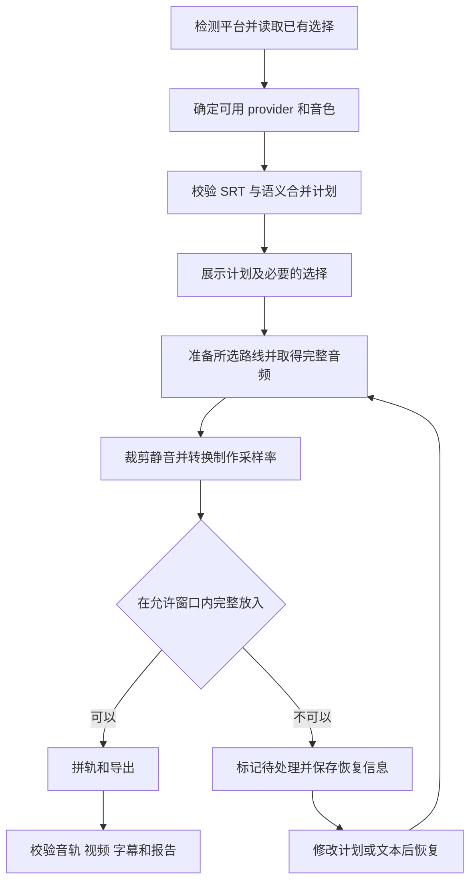

# video-tts Skill 优化技术需求文档

版本：1.0  
日期：2026-11-08  
实施对象：负责改造现有 video-tts skill 的 coding agent

本次在现有 Qwen3-TTS 与 mlx-audio 实现上优化配音完整性、时间适配、采样率、缓存、重试及交互。Apple Silicon 保留 MLX 路线，Windows 保留百炼在线路线。默认保留全部配音内容，将模型原生采样率与默认 48kHz 制作音轨分开，避免因字幕窗口或模型差异产生丢字、错误复用缓存及重复在线请求。

实施目标是改进现有 skill，不重写语音模型，不在本期强制更换 TTS 模型。应先读取仓库指令和当前实现，再根据本文件修改；本文所列接口名和新增参数是建议命名，行为要求必须落实。

# 1 实施范围

目标仓库：/Users/jasing/Documents/Work/perhapsjas_skill_market  
目标 skill：plugins/video-toolkit/skills/video-tts  
评估基线 commit：a34579895c56016f3ad4c42065bb2144b57a808b

保留现有视频或音频加中文 SRT 的输入方式，以及本地预设音色、VoiceDesign、Base 声音克隆、百炼在线、语义合并、只输出配音轨及视频混流等能力。保留现有音色目录和上游 video-downloader → audio-transcribe → text-refine → video-tts 链路。

本期不要求新增 VoxCPM2 provider、Windows 本地 CUDA TTS、背景音乐分离、自动翻译、口型同步、实时播音或训练。VoxCPM2 的 48kHz 输出只作为采样率扩展设计的参考，不作为必须下载和部署的新模型。

调用方已明确授权的选项应直接执行；缺少决定时才询问。不能为了优化流程新增反复确认。

# 2 当前基线与已确认问题

当前实现具有模型单次加载、语义合并、片段缓存、有限变速、音轨等长拼接及 FFmpeg 混流校验。保留这些结构。

本次评估在已安装的 Python 3.14 与 mlx-audio 0.6.4 环境下，得到 218 项默认测试通过、1 项集成测试默认跳过；单独启用该 FFmpeg 集成测试后通过。集成测试使用模拟 provider，不代表真实 TTS 的听感、读字完整性或克隆质量已经验证。

| 编号 | 已确认行为 | 影响 |
| --- | --- | --- |
| F01 | 达到变速上限仍放不下时直接截断，且 failed 为 false，最终可返回 0 | 成片可能缺字，但被当成成功 |
| F02 | 参考音频只通过路径等字符串进入缓存键，同路径替换内容后仍命中 | 克隆可能继续使用旧声音 |
| F03 | 在线 provider 最多 3 次尝试，外层引擎又尝试 2 次 | 模拟持续 HTTP 500 时，单片段共执行 6 次底层调用 |
| F04 | 合成 5 秒、字幕窗口 3 秒、下一句前可用 10 秒，仍规划为 1.15 倍速 | 解说场景出现可避免的加速 |
| F05 | 本地和在线 provider、引擎、缓存及音轨按固定 24kHz 协作 | 48kHz 模型不能直接接入 |
| F06 | 启动器可向现有 Python 安装未锁定依赖，Mac 使用 break-system-packages | 环境难复现，可能影响其他 skill |
| F07 | SKILL.md 约 650 行，多个确认步骤分散 | 上下文成本高；应合并问题，但仍必须使用 AskUserQuestion／等价结构化控件 |
| F08 | dry-run 与 merge-plan 组合会写 dub.srt，但另有说明宣称不写文件 | 预览语义不一致，可能覆盖已有计划产物 |

F01、F04 属于需要改变的产品策略，不是把旧设计误判为实现错误。F02、F03 已通过隔离的模拟复现，不能因为现有测试全通过而忽略。

# 3 优先级

| 优先级 | 本期要求 |
| --- | --- |
| P1 | 默认不截断；修复克隆缓存；统一重试与提交状态；采样率正确传递 |
| P2 | 自然与严格同步模式；任务恢复和完整报告；原子写入；隔离且锁定依赖 |
| P2 | 先检测能力再展示选项；合并重复确认；精简主 SKILL.md；修正 dry-run |
| 后续可选 | VoxCPM2、批量推理、克隆参考条件缓存、质量筛查自动化、背景音乐混合 |

P1 和 P2 均纳入本次交付；可选项不阻塞基本改造，也不得未经说明扩大范围。

# 4 平台与模型策略

| 环境或模式 | 实现路线 |
| --- | --- |
| Apple Silicon Mac 本地 | mlx-audio 与 MLX／Metal，保留现有 Qwen3-TTS |
| Intel Mac 本地 | 本期不声明支持；引导选择在线 |
| Windows 本地 | 本期不新增；不能展示为可执行选项 |
| Mac 或 Windows 在线 | 保留百炼 bl 优先与现有 HTTP 兜底能力 |
| WSL、Windows ARM 等 | 显示实际环境与已验证能力，不按系统名称猜测兼容性 |

保留模型：

| 用途 | 默认模型 |
| --- | --- |
| 预设音色 | mlx-community/Qwen3-TTS-12Hz-1.7B-CustomVoice-bf16 |
| 自由音色设计 | mlx-community/Qwen3-TTS-12Hz-1.7B-VoiceDesign-bf16 |
| 参考音频克隆 | mlx-community/Qwen3-TTS-12Hz-1.7B-Base-bf16 |
| 在线旗舰 | qwen-audio-3.1-tts-plus |
| 在线其他现有音色 | qwen3-tts-flash |

保留模型与音色的现有互斥、匹配校验。不会因为性能不足自动改用 0.6B、其他模型或在线 provider。新量化配置需独立验证后开放，不在本期默认更换 BF16。

# 5 用户交互流程

## 标准顺序

1. 检测实际执行系统、架构及基础工具，确认输入文件。
2. 读取本次请求已指定的 provider、音色、参考音频、语气和输出方式。
3. 只展示当前平台可用的配音方式。Mac 可以选择本地或在线，Windows 默认只展示在线，并说明本地 MLX 不可用。
4. 按已选路线收集缺失的音色或克隆设置，不重复询问已明确内容。
5. 解析 SRT，生成或复用经过验证的语义合并计划，展示条目数、合并组数、时长及潜在超长组。
6. 展示执行摘要；确有待决定内容时，合并为一次开始或预览选择。在线摘要同时包含上传与付费信息，复用已有授权，不再分成两轮重复确认。
7. 仅准备所选路线的环境、凭证和模型，然后执行。
8. 交付产物与报告，突出未解决的超长组、失败组或显式裁剪记录。



## 跨宿主交互

凡是需要用户选择或决策的地方，一律使用 AskUserQuestion；其他宿主使用等价的结构化用户输入控件。工具 schema 与分页限制按宿主实际能力适配。普通文本只用于说明和进度，不代替选择控件；没有可用控件时说明能力缺失，等待用户明确指令。已经明确的选择和授权继续生效，不重复提问。

用户直接要求开始且所需信息已齐全时，无需再问是否开跑。在线调用仍需用户知道它使用在线付费服务；一次明确授权覆盖本次已指定批次。变更计费方式、provider 或扩大处理文件范围时再收集新的选择。

先检测平台再提供原声克隆推荐。Windows 本期没有本地克隆实现时，不能先推荐克隆再让用户发现不可用。

# 6 音频结果接口与采样率

## 三层采样率

1. source_sample_rate：provider 实际输出的采样率，例如当前 Qwen 的 24000。
2. master_sample_rate：本项目内部拼轨和时间适配使用的采样率，默认 48000。
3. export_sample_rate：最终 WAV 和视频音轨采样率，默认与 master 相同，避免重复转换。

24kHz 升采样到 48kHz 统一的是制作规格，不会恢复模型未生成的高频细节。Qwen 官方当前语音 tokenizer 的输出配置为 24000；不要通过改常量假装模型原生输出变成 48000。[Qwen 官方配置](https://huggingface.co/Qwen/Qwen3-TTS-12Hz-1.7B-CustomVoice/blob/main/speech_tokenizer/config.json)

## Provider 结果

将只返回 ndarray 的协议升级为携带元数据的结构，例如：

```python
@dataclass
class SynthesisResult:
    audio: np.ndarray
    sample_rate: int
    channels: int
    provider: str
    model_id: str
    model_revision: str | None
    request_id: str | None = None
```

audio 的声道布局必须统一定义，例如单声道为 frames、双声道为 frames 与 channels。禁止通过 reshape(-1) 把双声道交错样本当成单声道，造成时长和音高错误。下混时明确按声道求均值或采用记录在案的混音策略。

provider 的 sample_rate 以真实生成结果或可验证的模型元数据为准。缺失或冲突时明确报错，不默认标成 24000。在线请求可以继续选择服务支持的 24kHz，但返回后仍读取实际 WAV 元数据。

若短期需要兼容旧 ndarray provider，使用显式声明采样率的适配器；不得猜测采样率。

## 处理顺序

```text
取得完整的原生音频及元数据
→ 校验并保存原生音频缓存
→ 在原生采样率上保守裁剪首尾静音
→ 正确下混
→ 重采样至 master_sample_rate
→ 用转换后真实样本数计算时长
→ 时长规划与有限变速
→ 拼轨
→ 按 export_sample_rate 导出
```

优先复用 FFmpeg 的重采样能力；若使用 Python 重采样器，必须明确算法和版本。禁止仅修改 WAV 文件头、写入采样率或变量值来“转换”音频。

本期 master 和 export 默认同为 48000；允许显式选择 24000 或 44100 等已测试配置。缓存和报告不得混淆原生、处理、导出采样率。

生成器处理必须遵守锁定版本的 API。显式使用非流式模式；若 API 返回多个片段，应按其实际分片语义收集完整音频。不能假定任意模型的首个 yield 都是完整结果，也不能把累积结果重复拼接。当前 Qwen 路线需有针对完整输出的回归测试。

# 7 时间适配与完整性

## 自然解说模式

新增 timing_mode，默认 natural。

natural 优先保持原速。每组起点采用经过处理的有效起点；允许结束时间延伸到下一组的实际边界之前，使用可配置的安全间隔。不能穿过用户指定的硬边界，例如镜头切换或明确停顿边界。

规划顺序：

1. 原速在允许窗口内放得下，使用 1.0 倍速。
2. 否则按实际可用窗口计算所需倍率，倍率不超过 max_speed 时变速。
3. 超过警告阈值时记录 accelerated 警告和倍率，但仍保留完整内容。
4. 超过 max_speed 则进入 overflow，不直接截断。

示例：合成 5 秒，字幕自身 3 秒，下一组前可用 10 秒，没有硬边界，natural 必须使用 1.0 倍速；不得为了对齐 3 秒槽位先加速到 1.15。

## 严格同步模式

strict_slot 使用字幕或合并组自身的有效结束时间作为硬边界，不借用之后空档。可以在 max_speed 范围内变速，但不越界、不减速拖长，也不默默丢字。

保留现有 max_speed 默认 1.30 和 warn_speed 默认 1.15，允许显式配置。所有时间计算均使用实际有效起点，不以已经被重叠推迟之前的窗口长度计算。

## 超长处理

新增 overflow_policy，默认 error；truncate 必须由用户显式启用。

默认 error 时：

- 标记超长组为 needs_attention，并记录合成时长、可用窗口、所需倍率及预计缺口。
- 保存完整原生音频、已完成组和恢复清单。
- 当前任务不报告完整成功，不把缺句音轨作为正常最终成品。
- 用户可调整合并边界、允许的变速上限，或让上游在授权下精简文本后恢复。
- 不默认改写字幕内容；不靠反复随机重生成“碰碰运气”缩短音频。

显式 truncate 时，允许按边界裁剪并淡出，但必须记录裁剪秒数和原始文本，最终状态为 completed_with_warnings；不得报告普通 complete。

删除现有“50ms 内裁剪不算截断”的宽泛豁免。采样点取整只允许不超过 1ms 的边界修正；更长修正必须记录，涉及有效语音的修正按 overflow 处理。

# 8 语义合并与字幕

保留以语义单元合成为主的策略，并改进以下约束：

- 合并计划覆盖所有有效条目，恰好一次、顺序一致、组内连续。
- 除索引外记录源 SRT 内容哈希，输入变化后重新校验。
- 计划保留 source_indices、原始文本、配音文本和时间边界的映射。
- 不能跨说话人、明确硬边界或显著场景切换强行合并。
- 没有句末标点的原始字幕，允许根据语义判断边界，不要求机械补句号才算完整。
- 修复对中文片段拼接时无条件补逗号的倾向。例如“这个模”与“型很好”应成为“这个模型很好”，而不是“这个模，型很好”。是否加标点应由经过审核的合并文本或可靠规则决定。
- 对超长组提供字数与时长风险提示，默认约 18 秒作为计划建议，不把估算当作实际 TTS 时长。
- 逐条合成仍可显式选择，适用于用户要求的严格同步场景。

区分两类字幕：

| 文件 | 含义 |
| --- | --- |
| plan.srt | 合并计划及输入时间窗口，用于预览 |
| dub.srt | 依据实际配音起止时间输出的块级字幕 |

dub.srt 的时间不能简单复制计划窗口：自然模式可能延长，变速也会改变实际结束时间。它是组级字幕，不代表已完成字级强制对齐。保留原始 SRT，不覆盖输入。

字幕必须 UTF-8、编号连续、时间有效、按序排列，不把丢字或越界包装成有效字幕。

# 9 缓存与克隆参考

## 缓存键

引入缓存 schema v2，使用稳定的结构化序列化后计算 SHA-256，避免用不带转义的分隔符拼接字段。

至少纳入：

- provider、实际 model_id、已解析 revision 和后端版本。
- 预设音色 ID，或完整 VoiceDesign 描述。
- 配音文本、语言、语气、采样参数、seed 及影响合成的在线参数。
- 克隆参考音频的内容 SHA-256、参考文本，以及影响参考处理的设置。
- 原生音频输出配置或请求的音频规格。

不能只用参考音频路径、文件名或修改时间判断身份。哈希在任务准备阶段计算一次并复用，不要每组重复读完整文件。

验收关键场景：同一路径用不同声音覆盖，参考文字不变，下次必须重新合成；内容相同但移动路径可以复用。

## 缓存内容

原生音频缓存包含完整、经过基本有效性校验的合成结果及真实采样率，不缓存最终截断音频。时间窗、atempo、静音处理属于后续处理阶段。

改变制作采样率、字幕时间窗或 max_speed 时，优先复用原生音频，仅重新处理和拼轨，避免重复在线合成。

如果保留加工后的二级缓存，必须单独包含重采样算法、静音策略、变速参数和处理版本。

旧版无可靠元数据的缓存默认不作为 v2 命中，不批量删除旧缓存。提供清理说明，迁移过程不影响其他任务。

缓存写入采用临时文件与原子替换；损坏缓存按未命中处理。缓存写失败应记警告，不让已经取得的有效音频失效。

# 10 统一重试与任务恢复

## 一个地方控制合成重试

取消引擎与 provider 的嵌套重试。由一个统一调度层维护每组的总尝试预算，默认最多 3 次合成提交，首次包含在内。provider 负责返回可判断的错误分类和请求信息，不自行无限重试。

| 错误或阶段 | 行为 |
| --- | --- |
| 参数、音色不匹配、401、403、额度不足 | 立即停止，修复条件后由用户恢复 |
| 429 或明确可重试的暂时拒绝 | 在总预算内退避，遵守 Retry-After |
| 明确尚未提交的连接失败 | 在预算内重试 |
| 提交后超时，无法确认是否已处理 | 标记 submission_unknown，不自动重新合成 |
| 合成成功，音频下载失败 | 保存 audio_url 或请求标识，重试下载，不重新合成 |
| 空音频、NaN 或错误采样率 | 按错误类型有限处理，记录每次尝试，不缓存坏结果 |
| atempo、拼轨或混流失败 | 复用已合成音频，只重做失败加工阶段 |

即使 CLI 只给出非零退出码，也不能把所有 timeout 文本都当作安全重提信号。输出不够判断提交状态时，按 unknown 处理并保留可诊断信息。

下载重试预算与合成提交预算分开记录。不可恢复时返回失败，不自动换本地、在线、模型或音色。

## 恢复清单

每个任务保存 job manifest，记录输入指纹、配置、计划、模型版本、每组状态、缓存引用、提交次数及加工结果。提供 resume 能力。

修改一组文本后，只重新合成受影响的组。修改时间窗或制作采样率后，复用已有原生音频。输入、参考音频、模型版本和参数不匹配时，不能错用旧分块。

失败、取消或超长停止时，至少落盘任务状态和已完成结果。已提交在线任务的取消不保证撤销费用，状态说明应准确。

# 11 隔离环境与版本锁定

run.py 保留可复用环境的目标，但改为优先使用该 skill 的专用环境或用户显式指定的兼容环境。不能在多个全局解释器间循环 pip 安装直到碰巧成功。

本期要求：

- 本地与在线依赖分别维护，使用经过测试的版本约束或 lock 文件。
- 不默认使用 break-system-packages，不修改系统 Python、Homebrew 或其他 skill 的环境。
- 检查完整能力而不仅是 import mlx_audio：包含解释器架构、Metal 运算、所需 TTS API 和模型类型。
- Apple Silicon 上的 Intel Python 或 Rosetta 环境要准确识别并给出修复步骤。
- Windows 不安装 mlx-audio；只准备在线与媒体处理依赖。
- 模型下载延迟到实际选择并执行本地路线，缓存齐全时支持离线运行。
- bl 使用当前可验证的 CLI 版本和能力，版本不匹配时输出具体说明，不自行全局升级。
- 安装、登录、下载和加载分别显示状态，不把全部初始化都表现为“卡住”。

缺 FFmpeg 时按平台展示有效安装建议，不能在 Windows 输出 brew install 作为唯一方案。

# 12 音频处理与成品导出

## 音频完整性

保留 NaN、Inf、空音频和静音检查。短于 0.2 秒不能一律认定无效：极短语气词可能有效，应依据文本、采样点和可配置策略判断。

静音裁剪采用保守设置并保留首尾余量；阈值、padding 和处理版本可配置，避免切掉气声、轻辅音和低音量起音。记录裁剪前后时长。

本期不新增强制响度归一化或音色效果。若保留相关处理，必须明确参数并保证不改变音高或造成削波。

## 拼轨与性能

输出轨长度与媒体时长一致；没有媒体时按最后一组允许结束时间确定。采样长度使用导出采样率计算，禁止沿用 24kHz 常量。

48kHz 会增加长片内存：例如一小时单声道 float32 整轨约 691MB，若同时保留全片 placements、master 和临时副本，内存会继续增长。因此使用磁盘片段、分块写入或内存映射，避免为整片保存多份完整波形。保留模型单次加载，不为每条 SRT 重载模型。

音频原生 24kHz 可先缓存，再按组转为 48kHz 并写入制作音轨。自然模式借用空档后仍须检查不与下一组重叠。

## 文件与混流

- WAV 记录实际导出采样率；视频 AAC 显式使用相同采样率，默认 48000。
- 保留当前音频编码配置，除非有实测理由调整；不以更高码率代替采样率适配。
- 不兼容视频编码的重编码策略沿用现有约定。
- 验收同时检查音频流和视频流时长，不能只验证视频时长。
- 默认容差建议保留 0.2 秒，同时确保没有缺失末段音频。
- 最终文件用临时路径生成，校验通过后原子替换；失败不能先覆盖、再删除用户原有成品。
- 默认拒绝覆盖已有产物，除非用户已明确授权覆盖并传递对应标记。
- 不同输入任务使用独立 segments 与临时目录，避免同名 cue 相互覆盖。

原声替换维持现有行为，默认不额外保留或混合背景音乐。以后添加背景音乐时应保留其原生质量，再统一到制作采样率。

# 13 dry run 与产物约定

dry-run 默认只读取输入、校验参数和输出计划，不加载模型、不联网、不合成、不覆盖或创建成品。

需要保存计划时，使用显式 write-plan 或等价参数，产物命名为 plan.json 和 plan.srt。不能在 dry-run 中写最终 dub.srt。已有调用依赖旧行为时，提供迁移说明与对应参数。

建议产物：

```text
job-directory/
  input.dub.wav
  input.dub.mp4
  input.dub.srt
  input.report.json
  input.job.json
  input.plan.json
  input.plan.srt
  segments/
```

保留现有 out 前缀和 track-only 语义；不要求用户必须采用新目录布局。报告与恢复清单默认生成，避免出错后没有诊断依据。keep-segments 控制额外的人工检查音频，不影响必要缓存和恢复。

有未解决 overflow 或合成失败时，不输出看似成功的完整成片。continue-on-error 可保留为显式模式，产物标记 partial，报告列出所有缺失组。

# 14 状态与机器可读报告

建议状态包括 planned、preparing、synthesizing、processing、exporting、complete、completed_with_warnings、needs_attention、partial、failed、cancelled、submission_unknown。

退出码约定：

- 0：完整成功，或没有内容裁剪的普通加速等警告。
- 1：运行失败、partial、needs_attention 或 submission_unknown。
- 2：参数、输入或计划错误。
- 3：用户显式允许裁剪且实际发生内容裁剪，生成了有损成品。不能被上游当作普通成功。

报告至少包含：

| 范围 | 字段 |
| --- | --- |
| 任务 | schema_version、job_id、状态、输入指纹、计划版本 |
| 环境 | 系统、架构、解释器、后端及媒体工具版本 |
| 模型 | 实际 model_id、revision、音色或克隆模式、采样参数 |
| 音频 | 原生采样率、制作采样率、导出采样率和声道 |
| 每组 | source_indices、文本、计划起止、实际起止、原始及裁剪后时长、最终时长、倍率 |
| 异常 | overflow 缺口、裁剪秒数、重试次数、错误类型、提交状态 |
| 性能 | 加载、合成、下载、处理、混流耗时及缓存命中情况 |
| 产物 | 校验通过的文件路径，缺失或失败文件不得列为有效 |

克隆参考记录内容指纹和必要配置，不把音频数据或敏感凭证塞入报告。在线日志不输出 API Key，带临时授权的 URL 保存在必要的私有任务状态中，不原样泄露到用户报告。

进度显示当前阶段、已完成组数、当前组和缓存命中。未知进度显示阶段，不虚构百分比。推理过程中没有可用组内进度时明确显示“当前组生成中”，并支持取消。

# 15 CLI 与兼容要求

保留现有 srt、video、audio、provider、voice、design、ref-audio、ref-text、instruct、lang、out、track-only、keep-segments、merge-plan、max-speed、yes 和模型覆盖等参数。

新增或提供等价能力：

| 建议参数 | 默认 | 含义 |
| --- | --- | --- |
| timing-mode | natural | natural 或 strict_slot |
| overflow-policy | error | error 或显式 truncate |
| master-sample-rate | 48000 | 内部与默认导出采样率 |
| resume | 不启用 | 从指定任务恢复 |
| overwrite | false | 显式覆盖成品 |
| write-plan | 不启用 | 保存预览计划 |
| dry-run | false | 无合成、无联网、默认无写入 |

source_sample_rate 由 provider 真实结果决定，不作为任意强制覆盖参数。高级输出规格需要验证后开放。

本次有意改变的默认行为必须写在迁移说明中：自然模式优先原速、超长默认停止、默认导出 48kHz、dry-run 不再隐式写 dub.srt、默认不覆盖、裁剪使用单独退出码。

清理 SKILL.md 中与代码不一致的表述，并将音色表、安装排障、模型能力与长示例移至按需读取的 references。主文档建议控制在约 200 行内，但不能为了行数删除关键行为约束。

# 16 验收测试

## 必须新增的回归场景

| 编号 | 输入或故障 | 通过条件 |
| --- | --- | --- |
| T01 | 同路径替换克隆参考音频，文本不变 | 缓存失效，重新合成 |
| T02 | 参考内容相同但移动路径 | 可复用缓存，不依赖路径身份 |
| T03 | 修改模型 revision、音色、语气或采样参数 | 正确失效，不返回旧声音 |
| T04 | 只改制作采样率或字幕时间窗 | 复用原生缓存，仅重加工 |
| T05 | 连续明确可安全重试的 HTTP 500 | 单组总合成调用不超过 3 次 |
| T06 | 在线合成成功，首次下载失败 | 只重试下载，合成请求仍为 1 次 |
| T07 | 提交后状态不明的超时 | submission_unknown，不自动重提 |
| T08 | 401、403、非法参数或额度不足 | 不做无效重试，不自动切 provider |
| T09 | natural，合成 5 秒，槽位 3 秒，可用 10 秒 | 原速 1.0，不丢字，不越界 |
| T10 | strict_slot，同样音频 | 使用槽位硬边界，无法完整放入则 needs_attention |
| T11 | 超过 max_speed 且未允许裁剪 | 保存完整音频，任务非成功，无伪完整成片 |
| T12 | 显式 truncate 且确实裁剪 | 完整记录裁剪，warning 状态，退出码 3 |
| T13 | 模拟 24kHz 一秒音频 → 48kHz | 输出约 48000 样本，时长与音调不变 |
| T14 | 模拟 48kHz provider | 直接通过，不因不是 24kHz 被拒绝 |
| T15 | 双声道音频输入 | 正确下混，时长不翻倍，不能直接展平 |
| T16 | 混合原生采样率的多个片段 | 主轨时间位置正确，无漂移和误速 |
| T17 | 多片段生成结果或空生成器 | 正确取得完整音频，或明确报错，不漏尾段 |
| T18 | 无标点的拆词字幕语义合并 | 不在词中间凭空插逗号，原条目映射完整 |
| T19 | dry-run 与 merge-plan | 不写成品；显式 write-plan 只写计划文件 |
| T20 | 最终输出已存在且新任务失败 | 原有成品不被覆盖或删除 |
| T21 | Windows、Intel Mac 和 Apple Silicon | 可用选项准确，只安装对应依赖 |
| T22 | 超长、取消、混流失败后 resume | 复用已成功组，报告和恢复状态完整 |
| T23 | 最终成片 | AAC 与采样率正确，音视频均等长，末句完整 |

合成接口与计费逻辑优先使用 mock 验证，不为测试异常路径发出真实付费请求。

## 真实音频验收

至少覆盖中文解说、英文术语或数字混入中文、预设音色、Base 克隆、长于 10 分钟的字幕配音，以及短语气词和轻声起音。

用同一批输入比较改造前后：漏读和截断数量、加速组数、跨组音色变化、起音和尾音是否被裁掉、整体耗时及峰值内存。纯正弦波测试不能代替听感和内容验收。

本地使用已缓存模型或明确准备好的模型；在线真实冒烟只在已有本次授权和额度范围内执行。未完成的真实模型、Windows 或在线验证必须在交付报告中标明，不能以 mock 通过代替。

至少提供一组“原先需要加速、现在可原速”的前后试听样例，以及一组克隆缓存失效回归结果。ASR 回转可辅助检测漏字，但不能单凭识别器结果评定音色和自然度。

# 17 Coding Agent 交付要求

1. 阅读现有实现与仓库指令，提交改造范围和参数迁移说明。
2. 修复 P1 与 P2，保留 Qwen3-TTS、MLX、本地及百炼在线现有能力。
3. 更新适配器、缓存、时间规划、混流验证、恢复清单与报告。
4. 更新并运行现有测试，新增对应回归场景；旧测试若断言了已改变的策略，应更新预期并解释原因。
5. 提供锁定依赖、各平台安装和恢复命令，不提交模型权重或凭证。
6. 提供真实音频验收记录、示例产物及未验证项目。
7. 精简 SKILL.md，确保文档、CLI 帮助和程序实际行为一致。

建议实施顺序：音频结果协议与采样率 → 缓存 v2 → 统一重试 → 时间规划与 overflow → 原子导出及恢复 → 交互与文档 → 回归和试听验收。

# 18 代码定位与外部参考

| 资料 | 用途 |
| --- | --- |
| [现有 SKILL.md](/Users/jasing/Documents/Work/perhapsjas_skill_market/plugins/video-toolkit/skills/video-tts/SKILL.md) | 当前用户流程与文档约束 |
| [engine.py](/Users/jasing/Documents/Work/perhapsjas_skill_market/plugins/video-toolkit/skills/video-tts/engine.py:117) | 缓存参数、外层重试和截断 |
| [audio_fit.py](/Users/jasing/Documents/Work/perhapsjas_skill_market/plugins/video-toolkit/skills/video-tts/audio_fit.py:53) | 时间适配、静音裁剪和变速 |
| [local_mlx.py](/Users/jasing/Documents/Work/perhapsjas_skill_market/plugins/video-toolkit/skills/video-tts/providers/local_mlx.py:135) | 生成器消费与固定采样率检查 |
| [online_bailian.py](/Users/jasing/Documents/Work/perhapsjas_skill_market/plugins/video-toolkit/skills/video-tts/providers/online_bailian.py:342) | 在线提交、重试及音频下载 |
| [cache.py](/Users/jasing/Documents/Work/perhapsjas_skill_market/plugins/video-toolkit/skills/video-tts/cache.py:25) | 缓存键与 WAV 存取 |
| [run.py](/Users/jasing/Documents/Work/perhapsjas_skill_market/plugins/video-toolkit/skills/video-tts/run.py:210) | 环境发现与依赖安装 |
| [skill_main.py](/Users/jasing/Documents/Work/perhapsjas_skill_market/plugins/video-toolkit/skills/video-tts/skill_main.py:549) | 预览、产物与报告编排 |
| [mux.py](/Users/jasing/Documents/Work/perhapsjas_skill_market/plugins/video-toolkit/skills/video-tts/mux.py:118) | 混流与成片校验 |
| [merge_plan.py](/Users/jasing/Documents/Work/perhapsjas_skill_market/plugins/video-toolkit/skills/video-tts/merge_plan.py:24) | 合并文本与源字幕映射 |
| [track_build.py](/Users/jasing/Documents/Work/perhapsjas_skill_market/plugins/video-toolkit/skills/video-tts/track_build.py:38) | 整轨分配、放置与写盘 |
| [Qwen3-TTS 官方项目](https://github.com/QwenLM/Qwen3-TTS) | 模型用途、接口及官方权重 |
| [Qwen 原生采样率配置](https://huggingface.co/Qwen/Qwen3-TTS-12Hz-1.7B-CustomVoice/blob/main/speech_tokenizer/config.json) | 24kHz 原生输出依据 |
| [mlx-audio Qwen3-TTS 接口](https://github.com/Neywa-Labs/mlx-audio/blob/main/mlx_audio/tts/models/qwen3_tts/README.md) | 预设、设计、克隆和生成器语义 |
| [VoxCPM2 MLX 接口](https://github.com/Neywa-Labs/mlx-audio/blob/main/mlx_audio/tts/models/voxcpm2/README.md) | 48kHz 扩展参考，本期不要求接入 |
| [FFmpeg 音频滤镜](https://ffmpeg.org/ffmpeg-filters.html) | aresample、atempo 等实际参数 |

本地代码行号对应评估基线，实施时以当前文件内容为准。外部接口按锁定版本核对，不以滚动分支文档替代实际兼容性测试。

# 19 给 Coding Agent 的执行指令

> 请按本文件优化现有 video-tts skill。先读取仓库指令和当前实现，保留现有 Qwen3-TTS 与 Apple Silicon MLX 路线、在线百炼和音色功能。本次重点修复克隆参考音频缓存失效、嵌套重试以及默认截断导致的缺字；将 provider 输出改为音频加真实采样率，默认制作和导出为 48kHz，保留模型原生 24kHz，不通过改文件头假装重采样。自然模式优先原速利用允许空档，严格模式守住字幕边界，放不下时默认停止并保存恢复信息。更新 dry-run、原子导出、报告、平台检测和隔离依赖，完成相应回归及真实音频验收。不要顺带替换模型或新增 VoxCPM2，也不要使用自动改写文本或自动切 provider 掩盖问题。交付实现、迁移说明、测试结果与未验证项目。
